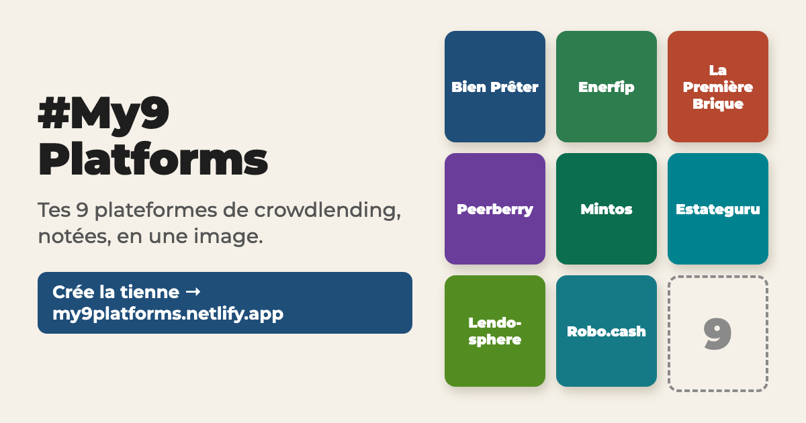

# #My9Platforms

Choisis tes 9 plateformes de crowdlending favorites, note-les et partage ta grille sur X.

👉 **https://my9platforms.netlify.app**

## Fonctionnalités

- **Grille 3×3** à composer parmi une quarantaine de plateformes (Bien Prêter, La Première Brique, Enerfip, Mintos…), ou en ajoutant les tiennes.
- **Note de 1 à 5 étoiles**, ordre modifiable (glisser-déposer ou ▲ ▼), couleur de chaque case personnalisable.
- **Partage sur X en un geste** :
  - sur mobile, le menu de partage s'ouvre avec l'image et le texte déjà joints ;
  - sur ordinateur, l'image est copiée et X s'ouvre avec le texte prêt : il ne reste qu'à coller (Ctrl+V / ⌘V).
- **Post pré-rédigé** : le classement en texte, ajusté pour tenir dans les 280 caractères de X, avec le lien du site.
- **« Défie 3 amis »** : les pseudos sont ajoutés au post.
- **Mention des plateformes** notées 4★ ou plus qui ont un compte X (désactivable).
- **Image en 1800×2260**, avec une case « Et toi ? » si la 9ᵉ est vide.

## Confidentialité

Aucun suivi, aucun serveur, aucune donnée envoyée. La grille est enregistrée uniquement dans le navigateur de l'utilisateur.

## Structure

Le site tient en un seul fichier, sans dépendance ni étape de build.

| Fichier | Rôle |
|---|---|
| `index.html` | Toute l'application : HTML, CSS et JavaScript |
| `og.png` | Image d'aperçu affichée quand le lien est partagé (1200×630) |

## Modifier la liste des plateformes

Dans `index.html` :

- **`PLATFORMS`** : une entrée par plateforme, `["Nom", "Catégorie", "#couleur"]`.
- **`X_HANDLES`** : le compte X officiel (sans @), uniquement pour les plateformes actives sur X. La clé doit correspondre exactement au nom utilisé dans `PLATFORMS`.

## Lancer en local

Ouvre simplement `index.html` dans un navigateur. Le partage direct (presse-papier, menu de partage) peut ne pas fonctionner selon le navigateur hors HTTPS : pour le tester, utilise le site en ligne.

## Déploiement

Le site est publié sur Netlify : chaque push sur `main` le met à jour automatiquement (pas de commande de build, dossier publié : la racine).

## Crédits

Idée de [@barbinvest](https://x.com/barbinvest).

## Licence

[MIT](LICENSE)
